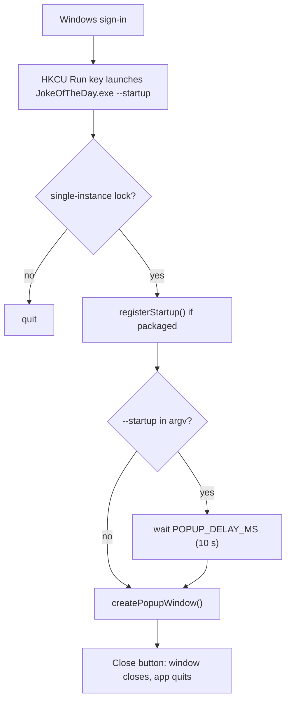

# Joke of the Day

A small Windows desktop app that pops up a joke shortly after you sign in, to start the day on a good note. It runs once per sign-in: the popup shows, you click **Close**, the app quits.

Jokes come from [JokeAPI](https://v2.jokeapi.dev) (Programming category, safe mode). Two-part jokes show the punchline separately. If the request fails or takes longer than 5 s, the popup shows "Could not load joke."

## Prerequisites and commands

- Windows 10/11
- Node.js 22.12+ (tested on 24.21) and npm. Older Node cannot run electron-vite 5, vitest 5, TypeScript 7 or the Electron installer.
- Git for Windows, with its `bin` folder on PATH

> **`NODE_ENV=production` breaks development.** npm then skips devDependencies, and Vite changes its behaviour. Remove it from your environment: in PowerShell, run `[Environment]::SetEnvironmentVariable('NODE_ENV', $null, 'User')`. For a machine-level value, run the same command with `'Machine'` in an admin PowerShell. Then restart your IDE and terminals. Until it is removed, use `npm install --include=dev`.

| Command | What it does |
|---|---|
| `npm install` | Install dependencies |
| `npm run dev` | Run the app with hot reload; the popup opens immediately |
| `npm test` | Run unit tests (vitest) |
| `npm run typecheck` | Type-check the whole project (`tsc --noEmit`) |
| `npm run build` | Build main, preload and renderer into `out/` |
| `npm run dist` | Build and package a Windows NSIS installer into `dist/` |
| `npm run icon` | Regenerate the app icon `resources/icon.png` (`scripts/generate-icon.mjs`, no dependencies) |

> **Packaging needs symlink rights.** `npm run dist` fails from a normal terminal unless **Settings › System › For developers › Developer Mode** is on. Otherwise run it from an admin terminal. The output is `dist/JokeOfTheDay Setup <version>.exe`. The "no node modules returned" message is expected: there are no runtime dependencies. The app, installer and uninstaller icon is `resources/icon.png`; regenerate it with `npm run icon`.

## Install & verify

1. Run `dist\JokeOfTheDay Setup <version>.exe`. No admin rights are needed; it installs per user to `%LOCALAPPDATA%\Programs\joke-of-the-day`.
2. The popup appears right after install. That first run registers the startup entry.
3. `reg query HKCU\Software\Microsoft\Windows\CurrentVersion\Run` shows `electron.app.JokeOfTheDay` pointing at `JokeOfTheDay.exe --startup`.
4. Sign out and back in: the popup appears about 10 s later.
5. Uninstall via **Settings › Apps › Installed apps**; the `electron.app.JokeOfTheDay` value is gone from the Run key.

## Project structure

```
src/
  main/                     Electron main process (Node)
    index.ts                App entry: single-instance lock, startup delay, quit on close
    startup.service.ts      Boot trigger: HKCU Run key registration, --startup detection
    window.service.ts       Creates the popup BrowserWindow
    joke.service.ts         getJoke(): fetches and parses a joke from JokeAPI
    ipc.ts                  IPC handlers (joke:get, popup:close)
    *.test.ts               Unit tests (vitest)
  preload/
    index.ts                Exposes window.jokeApi via contextBridge
  renderer/                 Popup UI (browser, sandboxed)
    index.html
    src/main.ts             Loads the joke, wires the Close button
    src/styles.css          Popup styles
    src/env.d.ts            window.jokeApi typing
  shared/
    constants.ts            POPUP_DELAY_MS, STARTUP_ARG, IPC_CHANNELS, window size
    types.ts                Joke, JokeApi
resources/                  Packaging assets (electron-builder buildResources)
  icon.png                  App icon (generated by npm run icon)
  installer.nsh             NSIS include: removes the Run key entry on uninstall
scripts/
  generate-icon.mjs         Dependency-free PNG icon generator
```

Imports use the `@/` alias for `src/` (configured in `tsconfig.json`, `electron.vite.config.ts` and `vitest.config.ts`).

## Boot trigger



- **Registration:** `registerStartup()` in `src/main/startup.service.ts` calls `app.setLoginItemSettings({ openAtLogin: true, args: ['--startup'] })`. On Windows this writes an entry under
  `HKCU\Software\Microsoft\Windows\CurrentVersion\Run`. That needs no admin rights. The entry is created on the first packaged launch (the NSIS installer runs the app after install) and refreshed on every launch.
- **Delay:** the Run key passes `--startup`. When `isLaunchedAtStartup(process.argv)` sees it, the popup waits `POPUP_DELAY_MS` (10 000 ms, in `src/shared/constants.ts`). Manual launches and `npm run dev` show the popup immediately.
- **Dev runs never register:** `registerStartup()` returns early when `app.isPackaged` is false, so `electron.exe` is never added to the Run key.
- **Verify:** Task Manager › Startup apps (look for *JokeOfTheDay*), or
  `reg query HKCU\Software\Microsoft\Windows\CurrentVersion\Run`
- **Disable:** turn it off in Task Manager › Startup apps. (`unregisterStartup()` exists in `startup.service.ts` but nothing calls it.)
- **Uninstall:** removes the `electron.app.JokeOfTheDay` value from the Run key (and from `Explorer\StartupApproved\Run`) via `resources/installer.nsh`. In-place updates keep it, since the new version re-registers it on launch.
- **Caveat:** Windows may add its own startup-app delay on top of the 10 s.

## Making changes

- **UI:** markup in `src/renderer/index.html`, behaviour in `src/renderer/src/main.ts`, styles in `src/renderer/src/styles.css`. Window size lives in `POPUP_WIDTH`/`POPUP_HEIGHT`.
- **Joke source:** `JOKE_API_URL` in `src/main/joke.service.ts` sets the category and flags. The request runs in the main process, so it needs no CORS or CSP changes.
- **New IPC calls:** add the channel to `IPC_CHANNELS` (`src/shared/constants.ts`), a handler in `src/main/ipc.ts`, the method on `JokeApi` (`src/shared/types.ts`), and the implementation in `src/preload/index.ts`.
