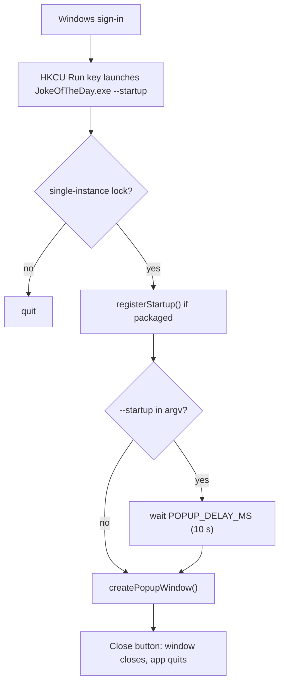

# Joke of the Day

A small Windows desktop app that pops up a joke shortly after you sign in, to start the day on a good note. It runs once per sign-in: the popup shows, you click **Close**, the app quits.

> **Status:** scaffolding only. The window shows placeholder text, has no styling, and does not call a joke API yet. See [Extension points](#extension-points-for-the-next-items).

## Prerequisites and commands

- Windows 10/11
- Node.js 22.12+ (tested on 24.21) and npm. Older Node cannot run electron-vite 5, vitest 5, TypeScript 7 or the Electron installer.
- Git for Windows, with its `bin` folder on PATH

> **`NODE_ENV=production` breaks development.** npm then skips devDependencies, and Vite changes its behaviour. Remove it from your environment: in PowerShell, run `[Environment]::SetEnvironmentVariable('NODE_ENV', $null, 'User')`. For a machine-level value, run the same command with `'Machine'` in an admin PowerShell. Then restart your IDE and terminals. Until it is removed, use `npm install --include=dev`.

| Command | What it does |
|---|---|
| `npm install` | Install dependencies |
| `npm run dev` | Run the app with hot reload; the popup opens immediately |
| `npm test` | Run unit tests (vitest) |
| `npm run typecheck` | Type-check the whole project (`tsc --noEmit`) |
| `npm run build` | Build main, preload and renderer into `out/` |
| `npm run dist` | Build and package a Windows NSIS installer into `dist/` |

> **Packaging needs symlink rights.** `npm run dist` fails from a normal terminal unless **Settings › System › For developers › Developer Mode** is on. Otherwise run it from an admin terminal. The output is `dist/JokeOfTheDay Setup <version>.exe`. The "default Electron icon is used" and "no node modules returned" messages are expected: no icon is set yet, and there are no runtime dependencies.

## Project structure

```
src/
  main/                     Electron main process (Node)
    index.ts                App entry: single-instance lock, startup delay, quit on close
    startup.service.ts      Boot trigger: HKCU Run key registration, --startup detection
    window.service.ts       Creates the popup BrowserWindow
    joke.service.ts         getJoke(): placeholder; the API seam
    ipc.ts                  IPC handlers (joke:get, popup:close)
  preload/
    index.ts                Exposes window.jokeApi via contextBridge
  renderer/                 Popup UI (browser, sandboxed)
    index.html
    src/main.ts             Loads the joke, wires the Close button
    src/env.d.ts            window.jokeApi typing
  shared/
    constants.ts            POPUP_DELAY_MS, STARTUP_ARG, IPC_CHANNELS, window size
    types.ts                Joke, JokeApi
```

Imports use the `@/` alias for `src/` (configured in `tsconfig.json`, `electron.vite.config.ts` and `vitest.config.ts`).

## Boot trigger



- **Registration:** `registerStartup()` in `src/main/startup.service.ts` calls `app.setLoginItemSettings({ openAtLogin: true, args: ['--startup'] })`. On Windows this writes an entry under
  `HKCU\Software\Microsoft\Windows\CurrentVersion\Run`. That needs no admin rights. The entry is created on the first packaged launch (the NSIS installer runs the app after install) and refreshed on every launch.
- **Delay:** the Run key passes `--startup`. When `isLaunchedAtStartup(process.argv)` sees it, the popup waits `POPUP_DELAY_MS` (10 000 ms, in `src/shared/constants.ts`). Manual launches and `npm run dev` show the popup immediately.
- **Dev runs never register:** `registerStartup()` returns early when `app.isPackaged` is false, so `electron.exe` is never added to the Run key.
- **Verify:** Task Manager › Startup apps (look for *JokeOfTheDay*), or
  `reg query HKCU\Software\Microsoft\Windows\CurrentVersion\Run`
- **Disable:** turn it off in Task Manager › Startup apps, or call `unregisterStartup()` (the hook for a future settings item).
- **Caveats:**
  - Windows may add its own startup-app delay on top of the 10 s.
  - The NSIS uninstaller does not remove the Run key yet. Disable the entry in Task Manager before uninstalling, or delete it with `reg delete`.

## Extension points for the next items

- **UI:** edit `src/renderer/index.html` and `src/renderer/src/main.ts`. Keep the `#close-button` → `window.jokeApi.closePopup()` behaviour. To add a framework (e.g. React), add its Vite plugin to the `renderer` section of `electron.vite.config.ts`. Window size lives in `POPUP_WIDTH`/`POPUP_HEIGHT`.
- **Joke API:** replace the body of `getJoke()` in `src/main/joke.service.ts` with a `fetch` call that maps the response to the `Joke` type and throws on failure. It runs in the main process, so no CORS or CSP changes are needed, and IPC, the preload bridge and the renderer's error fallback ("Could not load joke.") are already wired.
- **New IPC calls:** add the channel to `IPC_CHANNELS` (`src/shared/constants.ts`), a handler in `src/main/ipc.ts`, the method on `JokeApi` (`src/shared/types.ts`), and the implementation in `src/preload/index.ts`.
